<div align="center">



<br/>
<br/>

<a href="https://github.com/ishandutta2007/Awesome-Awesome-Awesome"></a><a href="https://discord.gg/jc4xtF58Ve"></a>
<a href="https://github.com/ishandutta2007/Awesome-Search-Analytics-Engines/stargazers"></a>
<a href="https://github.com/ishandutta2007/Awesome-Search-Analytics-Engines/network/members"></a>
<a href="https://github.com/ishandutta2007/Awesome-Search-Analytics-Engines/blob/main/LICENSE"></a>
<a href="https://github.com/ishandutta2007/Awesome-Search-Analytics-Engines/pulls"></a>
<a href="https://github.com/ishandutta2007/Awesome-Search-Analytics-Engines/commits/main"></a>
<a href="https://github.com/ishandutta2007"></a>

<br/>

# 🔍 Awesome Search & Analytics Engines

### *Curated Directory of Distributed Full-Text Search, Vector Retrieval, Log Analytics & Observability Platforms*

[](https://github.com/ishandutta2007/Awesome-Awesome-Awesome)
[](https://github.com/ishandutta2007/Awesome-Search-Analytics-Engines)
[-success.svg?style=flat-square)](https://github.com/ishandutta2007/Awesome-Search-Analytics-Engines)

</div>

---

## 📖 Overview & SEO Summary

Welcome to the definitive guide to modern **Search & Analytics Engines**! This repository tracks premier **hosted SaaS platforms** and **open-source systems** engineered to index, search, and analyze massive volumes of structured, semi-structured, and unstructured data.

Whether you are architecting a **site search autocomplete**, building high-throughput **distributed log analytics & observability pipelines**, implementing **semantic vector search / hybrid RAG retrieval**, or selecting an enterprise **e-commerce discovery engine**, this directory provides side-by-side pricing, company valuations, GitHub star rankings, and architectural trade-offs.

### 🎯 Key Focus Areas
- ⚡ **Distributed Full-Text Search**: Inverted indexes, BM25 scoring, typo tolerance, multi-language tokenization.
- 📊 **Log Analytics & Observability**: Real-time log aggregation, time-series metrics, PromQL compatibility, distributed trace indexing.
- 🧠 **Hybrid & Vector Search**: Dense vector embeddings, HNSW, kNN nearest neighbors, lexical-semantic reciprocal rank fusion (RRF).
- ☁️ **Cost-Effective Cloud Storage Search**: Decoupled compute-storage engines indexing directly to object storage (S3/GCS/Azure Blob).

---

## 📑 Table of Contents

- [📊 Sector Overview & Market Dynamics](#-sector-overview--market-dynamics)
- [☁️ SaaS / Hosted Search & Analytics Platforms](#️-saas--hosted-search--analytics-platforms)
- [🛠️ Open-Source Search & Analytics Engines](#️-open-source-search--analytics-engines)
- [🏗️ Architectural Comparison Matrix](#️-architectural-comparison-matrix)
- [🤝 How to Contribute](#-how-to-contribute)
- [💖 Support & Sponsoring](#-support--sponsoring)
- [⭐ Star History](#-star-history)
- [⚖️ Disclaimer & License](#️-disclaimer--license)

---

## 📊 Sector Overview & Market Dynamics

- 📈 **Estimated Market Size**: The global enterprise search and log analytics engine market is valued at approximately **$7.8 Billion in 2026** and is projected to expand to **$16.4 Billion by 2031**, progressing at an estimated CAGR of **15.8%**. Growth is heavily accelerated by explosive log generation across cloud-native microservices, AI-powered Retrieval-Augmented Generation (RAG) pipelines, and real-time enterprise observability requirements.
- 🌐 **Market Structure & Concentration**: The sector demonstrates **moderate concentration with specialized fragmentation**: foundational distributed search and observability engines follow an oligopolistic pattern anchored by the Lucene lineage (dominated by **Elasticsearch** and AWS-backed **OpenSearch**). Meanwhile, developer-first site search (e.g., **Algolia**, **Typesense**, **Meilisearch**), vector search databases (e.g., **Milvus**, **Qdrant**, **Chroma**), and specialized e-commerce discovery platforms (e.g., **Bloomreach**, **Searchspring**) maintain highly competitive, fragmented niches with strong retention rather than a single winner-take-all monopoly.

---

## ☁️ SaaS / Hosted Search & Analytics Platforms

The table below catalogs premier commercial and cloud-hosted search and analytics engines. **Sorted in descending order by Company Size (Market Cap or Valuation)**.

| 🏢 Platform / Service | 💰 Company Size (Valuation / Revenue) | 🏷️ Starting Tier Price | 🎁 Free Tier Limit | ⚙️ Primary Architecture & Highlights | 🎯 Best For |
| :--- | :--- | :--- | :--- | :--- | :--- |
| **[Amazon OpenSearch Service](https://aws.amazon.com/opensearch-service/)** | **~$1.95 Trillion** (Amazon Market Cap) / **~$105B+** AWS Annual Revenue | **$0.036/hour** (~$26.28/month) for `t3.small.search` instance + $0.10/GB-month EBS | **750 hours/month** of single-AZ `t2.small.search` or `t3.small.search` instance + 10GB EBS storage for **12 months** on AWS Free Tier | Fully managed OpenSearch & Elasticsearch clusters with automated scaling, multi-AZ high availability, VPC security, and Serverless compute options. | AWS cloud workloads requiring fully managed OpenSearch with native IAM & CloudWatch integration. |
| **[Elastic Cloud](https://cloud.elastic.co/)** *(Elasticsearch)* | **~$9.5 Billion** (NYSE: ESTC Market Cap) / **~$1.42B** Annual Revenue | **$95.00/month** ($0.1319/hour for Standard tier 2-zone 4GB RAM / 90GB storage) | **14-day free trial** with full Platinum/Enterprise features, 4GB RAM cluster, zero credit card required | The official hosted Elasticsearch, Kibana, Logstash, and Beats service. Features native PromQL, native vector kNN, cross-cluster search, and Elastic AI Assistant. | Teams demanding reference Elasticsearch architecture, native ELK stack support, and cutting-edge features. |
| **[Algolia](https://www.algolia.com/)** | **~$2.25 Billion** (Series D Valuation) / **~$100M+** ARR | **$0.50 per 1,000 requests** + **$0.40 per 1,000 records/month** (Grow Tier base) | **Free forever "Build" tier**: 10,000 search requests/month and 1,000,000 records with full instant search API | Ultra-low latency hosted search API with instant search-as-you-type, built-in typo tolerance, analytics, dynamic re-ranking, and NeuralSearch vector retrieval. | Product and frontend teams needing instantaneous site/app search with the fastest time-to-market. |
| **[Bloomreach](https://www.bloomreach.com/)** | **~$2.20 Billion** (Series F Valuation) / **~$150M+** ARR | **$1,500.00/month** (Discovery Commerce Search starting tier, billed annually) | **14-day guided proof-of-concept trial** sandbox with test catalog ingestion upon sales consultation | Commerce Experience Cloud integrating AI-driven product search, 1:1 personalization, visual merchandising rules, and customer data platform (CDP) signals. | Large-scale e-commerce retailers seeking automated merchandising and high-conversion catalog discovery. |
| **[Yext](https://www.yext.com/)** | **~$750 Million** (NYSE: YEXT Market Cap) / **~$405M** Annual Revenue | **$16.00/month** ($4.00/week billed annually for Emerging) or **$499.00/month** for Core Search | **14-day free trial** on Yext Search with up to 5,000 test query calls and knowledge graph sandbox | Knowledge Graph-driven multi-channel search platform delivering direct answers, conversational AI, and local business digital presence syncing. | Multi-location brands, healthcare systems, and enterprises managing structured location and entity search. |
| **[Coveo](https://www.coveo.com/)** | **~$480 Million** (TSX: CVO Market Cap) / **~$125M+** Annual Revenue | **$1,500.00/month** (Coveo Relevance Cloud Pro tier, annual commitment) | **30-day developer trial** on Coveo Cloud sandbox with sample enterprise connectors and AI relevance testing | AI-powered enterprise search and relevance platform with unified connectors for Salesforce, ServiceNow, SharePoint, SAP, and legacy enterprise databases. | Global enterprises requiring federated search, knowledge discovery, and GenAI answers across fragmented silos. |
| **[Lucidworks Fusion](https://lucidworks.com/)** | **~$450 Million** (Private Valuation) / **~$65M+** Annual Revenue | **$2,000.00/month** (Lucidworks Cloud starter configuration) | **14-day guided sandbox trial** access with pre-indexed document collections and visual query pipeline editor | Enterprise search and discovery platform engineered on Apache Solr with visual pipeline design, ML relevance tuning, and workplace semantic connectors. | Enterprises invested in the Apache Solr ecosystem wanting enterprise-grade UI, security, and SLA support. |
| **[Sinequa](https://www.sinequa.com/)** | **~$250 Million** (Private Valuation) / **~$50M+** Annual Revenue | **$2,083.33/month** ($25,000.00/year minimum entry enterprise license) | **30-day evaluation trial** proof-of-concept license with up to 100,000 indexed test documents | Cognitive search platform featuring 200+ out-of-the-box enterprise connectors, natural language understanding, neural search, and deep content analytics. | Regulated industries (pharmaceutical, aerospace, defense, banking) requiring complex on-prem/private cloud search. |
| **[Searchspring](https://searchspring.com/)** | **~$150 Million** (Private Valuation) / **~$35M+** Annual Revenue | **$599.00/month** (Essential tier for up to 50,000 monthly site visits) | **14-day full-featured free trial** with merchandising console, search relevance tuning, and test catalog | E-commerce site search, faceted navigation, merchandising rules, and automated product recommendations built for digital storefronts. | Mid-market e-commerce merchants on Shopify Plus, Magento, BigCommerce, and WooCommerce. |

---

## 🛠️ Open-Source Search & Analytics Engines

Below is the ranked catalog of premier open-source search, log analytics, and vector retrieval engines. **Strictly sorted in descending order by GitHub Star Count**.

---

### 1. [Elasticsearch](https://github.com/elastic/elasticsearch) [](https://github.com/elastic/elasticsearch/stargazers)
- 📜 **License**: SSPL 1.0 / Elastic License 2.0 (Dual licensed) | 💻 **Core Language**: Java
- ⚡ **Overview**: The world's most widely deployed distributed search and analytics engine. Powers full-text search, distributed inverted indexing with BM25 relevance scoring, complex aggregations, and log analytics as the foundational backbone of the ELK Stack.
- 🚀 **Key Capabilities**: Native vector search with HNSW and dense vector fields, Prometheus remote write with native PromQL execution, distributed sharding and replication, cross-cluster search.
- 🎯 **Best For**: Large-scale distributed full-text search, enterprise observability, and real-time log analytics.

---

### 2. [Meilisearch](https://github.com/meilisearch/meilisearch) [](https://github.com/meilisearch/meilisearch/stargazers)
- 📜 **License**: MIT | 💻 **Core Language**: Rust
- ⚡ **Overview**: A lightning-fast, hyper-relevant search engine designed for instant search-as-you-type experiences. Requires zero configuration to provide typo tolerance, synonyms, stop words, and faceted navigation out of the box.
- 🚀 **Key Capabilities**: Sub-50ms latency response, AI-powered hybrid lexical-semantic search with vector embeddings, tenant tokens for secure multi-tenancy, single self-contained binary in Rust with zero runtime dependencies.
- 🎯 **Best For**: Frontend web applications, e-commerce site search, and developer-friendly instant search-as-you-type.

---

### 3. [Milvus](https://github.com/milvus-io/milvus) [](https://github.com/milvus-io/milvus/stargazers)
- 📜 **License**: Apache 2.0 | 💻 **Core Language**: Go / C++
- ⚡ **Overview**: Cloud-native distributed vector database built from the ground up for massive-scale vector similarity search and AI analytics. Handles tens of billions of vector embeddings with millisecond retrieval.
- 🚀 **Key Capabilities**: Compute-storage disaggregation, support for numerous vector indexing algorithms (HNSW, IVF-FLAT, SCaNN, DiskANN), hybrid filtering with scalar attributes, hardware acceleration (GPU/FPGA).
- 🎯 **Best For**: High-throughput AI search, billion-scale vector similarity retrieval, recommendation systems, and multimodal search.

---

### 4. [Qdrant](https://github.com/qdrant/qdrant) [](https://github.com/qdrant/qdrant/stargazers)
- 📜 **License**: Apache 2.0 | 💻 **Core Language**: Rust
- ⚡ **Overview**: High-performance, production-ready vector database and semantic search engine with an advanced payload-based filtering engine. Written in Rust for maximum memory safety and predictable latency.
- 🚀 **Key Capabilities**: Extended vector filtering payload support, hybrid search combining dense vectors with sparse BM25 token weights, distributed clustering via Raft, SIMD-accelerated distance metrics, disk-backed vector storage.
- 🎯 **Best For**: Production RAG systems, semantic neural search, LLM memory backends, and filtered vector retrieval.

---

### 5. [Chroma](https://github.com/chroma-core/chroma) [](https://github.com/chroma-core/chroma/stargazers)
- 📜 **License**: Apache 2.0 | 💻 **Core Language**: Python / Rust
- ⚡ **Overview**: The AI-native open-source embedding database designed for developer productivity. Powers LLM application memory, document search, and RAG retrieval pipelines with minimal boilerplate.
- 🚀 **Key Capabilities**: Built-in embedding model generation, multimodal document indexing, full-text lexical search alongside vector search, simple Python and JavaScript client SDKs, serverless and distributed deployment modes.
- 🎯 **Best For**: AI engineers, rapid prototyping of RAG applications, LLM agent memory, and lightweight semantic search.

---

### 6. [Typesense](https://github.com/typesense/typesense) [](https://github.com/typesense/typesense/stargazers)
- 📜 **License**: GPL 3.0 | 💻 **Core Language**: C++
- ⚡ **Overview**: The premier open-source Algolia alternative engineered specifically for delightful developer experience and typo-tolerant search. Delivers sub-50ms search on billions of documents.
- 🚀 **Key Capabilities**: Built-in typo tolerance handling letter transpositions and missing characters, hybrid search combining keyword and vector retrieval, geosearch, dynamic faceting, Raft-based clustering without ZooKeeper or external coordinators.
- 🎯 **Best For**: Web, mobile, and e-commerce site search requiring out-of-the-box typo tolerance and instant filtering.

---

### 7. [Sonic](https://github.com/valeriansaliou/sonic) [](https://github.com/valeriansaliou/sonic/stargazers)
- 📜 **License**: MPL 2.0 | 💻 **Core Language**: Rust
- ⚡ **Overview**: Ultra-fast, lightweight, schema-less search backend designed as a minimalist alternative to heavy search engines like Elasticsearch when only autocomplete and query suggestion are required.
- 🚀 **Key Capabilities**: Extremely low RAM consumption (operates smoothly in tens of megabytes), microsecond query latency, custom lightweight Sonic Channel protocol, in-memory index with persistent storage.
- 🎯 **Best For**: Autocomplete dropdowns, search query suggestions, lightweight chat/messaging search, and constrained edge hardware.

---

### 8. [ZincSearch](https://github.com/zincsearch/zincsearch) [](https://github.com/zincsearch/zincsearch/stargazers)
- 📜 **License**: Apache 2.0 | 💻 **Core Language**: Go
- ⚡ **Overview**: A lightweight modern search engine written in Go, crafted as an operational alternative to Elasticsearch for log indexing and document search without JVM memory overhead.
- 🚀 **Key Capabilities**: Single binary distribution, embedded indexing engine (powered by Bluge/Bleve), built-in web UI for query inspection and user management, Elasticsearch-compatible ingestion APIs.
- 🎯 **Best For**: Small-to-medium log aggregation setups, development environments, and resource-efficient search indexing.

---

### 9. [Weaviate](https://github.com/weaviate/weaviate) [](https://github.com/weaviate/weaviate/stargazers)
- 📜 **License**: BSD 3-Clause | 💻 **Core Language**: Go
- ⚡ **Overview**: Open-source, cloud-native vector search engine with native modular machine learning integration. Allows querying data with vectors, keywords (BM25), and structured filters simultaneously.
- 🚀 **Key Capabilities**: Hybrid search (BM25 + vector cosine/dot product fusion), generative search modules for RAG, multi-modal vector search, GraphQL and REST APIs, horizontal scalability with sharding.
- 🎯 **Best For**: Complex AI applications, semantic search with structured graph relations, and generative RAG pipelines.

---

### 10. [Tantivy](https://github.com/quickwit-oss/tantivy) [](https://github.com/quickwit-oss/tantivy/stargazers)
- 📜 **License**: MIT | 💻 **Core Language**: Rust
- ⚡ **Overview**: A high-performance full-text search engine library inspired by Apache Lucene and written in Rust. Forms the core indexing and retrieval engine underlying Quickwit and multiple modern search systems.
- 🚀 **Key Capabilities**: Blazing-fast indexing and query speeds, memory-mapped inverted indexes, SIMD-accelerated bit-packing, faceted search, BM25 scoring, and zero JVM garbage collection pauses.
- 🎯 **Best For**: Systems engineers building custom embedded search engines, desktop applications, or distributed search services in Rust.

---

### 11. [OpenSearch](https://github.com/opensearch-project/OpenSearch) [](https://github.com/opensearch-project/OpenSearch/stargazers)
- 📜 **License**: Apache 2.0 | 💻 **Core Language**: Java
- ⚡ **Overview**: The 100% open-source, community-driven fork of Elasticsearch and Kibana created by AWS and industry partners following Elastic's license change.
- 🚀 **Key Capabilities**: Elasticsearch API compatibility for ingestion and search, vector search via k-NN plugin, SQL/PPL query interfaces, anomaly detection, distributed alerting, OpenSearch Dashboards.
- 🎯 **Best For**: Organizations mandating strict Apache 2.0 licensing for enterprise search, log analytics, and security observability.

---

### 12. [Manticore Search](https://github.com/manticoresoftware/manticoresearch) [](https://github.com/manticoresoftware/manticoresearch/stargazers)
- 📜 **License**: GPL 2.0 | 💻 **Core Language**: C++
- ⚡ **Overview**: High-speed open-source search and analytics database with native SQL support, evolved from Sphinx Search. Provides a drop-in relational query interface for full-text and vector search.
- 🚀 **Key Capabilities**: Full SQL syntax support (`SELECT ... WHERE MATCH(...)`), real-time indexing, significantly lower RAM consumption than Lucene-based engines, columnar storage for high-speed aggregations, vector search support.
- 🎯 **Best For**: Relational database teams wanting search without learning query DSLs, high-throughput log indexing, and Sphinx migrations.

---

### 13. [Quickwit](https://github.com/quickwit-oss/quickwit) [](https://github.com/quickwit-oss/quickwit/stargazers)
- 📜 **License**: AGPL 3.0 / Apache 2.0 | 💻 **Core Language**: Rust
- ⚡ **Overview**: Sub-second search engine designed specifically for cloud storage (Amazon S3, Google Cloud Storage, Azure Blob). Built on Tantivy to deliver unmatched cost efficiency for massive log and trace data.
- 🚀 **Key Capabilities**: Stateless indexing and query architecture, direct execution on cloud object storage without local persistent SSDs, native Jaeger distributed trace search, Elasticsearch query API compatibility.
- 🎯 **Best For**: Cost-effective log management, long-term observability retention, and petabyte-scale trace search.

---

### 14. [Bleve](https://github.com/blevesearch/bleve) [](https://github.com/blevesearch/bleve/stargazers)
- 📜 **License**: Apache 2.0 | 💻 **Core Language**: Go
- ⚡ **Overview**: Modern text indexing and search library written purely in Go. Provides advanced indexing capabilities directly embedded inside Go programs without running external search daemons.
- 🚀 **Key Capabilities**: Text, numeric, geospatial, and date indexing, customizable text analyzers and tokenizers, pluggable storage backends (BoltDB, Badger, LevelDB), faceted search, scoring via TF-IDF and BM25.
- 🎯 **Best For**: Go developers needing embedded full-text search directly within applications (e.g., Couchbase, Gitea).

---

### 15. [ParadeDB](https://github.com/paradedb/paradedb) [](https://github.com/paradedb/paradedb/stargazers)
- 📜 **License**: AGPL 3.0 | 💻 **Core Language**: Rust / C
- ⚡ **Overview**: The modern Elasticsearch alternative built directly on top of PostgreSQL. Transforms PostgreSQL into a full-text search and analytical search engine using custom pg_search and pg_analytics extensions.
- 🚀 **Key Capabilities**: Powered by Tantivy inside Postgres, BM25 full-text indexing, real-time ACID updates without separate sync pipelines or ETL lag, integration with standard SQL queries and Postgres tools.
- 🎯 **Best For**: Postgres-centric stacks seeking to eliminate external Elasticsearch clusters while retaining high-performance BM25 search.

---

### 16. [Vespa](https://github.com/vespa-engine/vespa) [](https://github.com/vespa-engine/vespa/stargazers)
- 📜 **License**: Apache 2.0 | 💻 **Core Language**: C++ / Java
- ⚡ **Overview**: Yahoo's battle-tested search and AI computation platform designed for low-latency processing over massive datasets. Unifies vector search, lexical BM25 search, and real-time ML model re-ranking at scale.
- 🚀 **Key Capabilities**: Native hybrid search with Reciprocal Rank Fusion (RRF), real-time evaluation of machine learning models (ONNX, PyTorch) during query execution, distributed sharding, high concurrency.
- 🎯 **Best For**: Web-scale search applications, personalized recommendation feeds, and AI search with complex ranking functions.

---

### 17. [Apache Lucene](https://github.com/apache/lucene) [](https://github.com/apache/lucene/stargazers)
- 📜 **License**: Apache 2.0 | 💻 **Core Language**: Java
- ⚡ **Overview**: The legendary, gold-standard open-source search library that powers Elasticsearch, Apache Solr, and OpenSearch. Provides ultra-optimized inverted indexing and vector capabilities.
- 🚀 **Key Capabilities**: Highly mature BM25 relevance scoring, Lucene codecs, segment merging, dense vector indexing via HNSW, extensive linguistic analyzers and tokenizers for dozens of languages.
- 🎯 **Best For**: The foundational foundation powering top-tier search engines and specialized Java enterprise retrieval systems.

---

### 18. [Apache Solr](https://github.com/apache/solr) [](https://github.com/apache/solr/stargazers)
- 📜 **License**: Apache 2.0 | 💻 **Core Language**: Java
- ⚡ **Overview**: The venerable, battle-tested enterprise search platform built on Apache Lucene with over two decades of production deployments across Fortune 500 enterprises.
- 🚀 **Key Capabilities**: SolrCloud distributed cluster architecture via ZooKeeper, faceted search, hit highlighting, rich document parsing with Apache Tika, JSON/XML/HTTP APIs.
- 🎯 **Best For**: Enterprise document repositories, digital libraries, and organizations with deep existing SolrCloud infrastructure.

---

## 🏗️ Architectural Comparison Matrix

| 🛠️ Engine | 🎯 Primary Category | 💻 Language | 💾 Index Storage | ⚡ Typical Latency | 🧠 Vector & Hybrid Search | 📜 License |
| :--- | :--- | :--- | :--- | :--- | :--- | :--- |
| **Elasticsearch** | Full-Text & Log Analytics | Java | Local SSD / EBS | 10–50 ms | ✅ Native (HNSW + BM25) | SSPL 1.0 / Elastic 2.0 |
| **Meilisearch** | Site & App Search | Rust | Local Disk (LMDB) | 5–25 ms | ✅ Hybrid Embeddings | MIT |
| **Milvus** | Distributed Vector DB | Go / C++ | Cloud / Disaggregated | 5–30 ms | ✅ Vector Native (All indexes) | Apache 2.0 |
| **Qdrant** | Vector Search & Payload | Rust | RAM / Disk Backed | 5–20 ms | ✅ Hybrid (Dense + Sparse) | Apache 2.0 |
| **Chroma** | AI Embedding Store | Python / Rust | SQLite / Parquet | 10–40 ms | ✅ Vector Native | Apache 2.0 |
| **Typesense** | Site & Catalog Search | C++ | RAM / Mapped SSD | 5–20 ms | ✅ Hybrid (Vector + Lexical) | GPL 3.0 |
| **Sonic** | Autocomplete / Identifier | Rust | In-Memory + Disk | 1–5 ms | ❌ Lexical Only | MPL 2.0 |
| **ZincSearch** | Lightweight Log Search | Go | Local Disk / S3 | 20–80 ms | ⚠️ Basic | Apache 2.0 |
| **Weaviate** | Vector & Knowledge Search | Go | LSM Tree / Inverted | 10–30 ms | ✅ Hybrid (BM25 + Dense) | BSD 3-Clause |
| **Tantivy** | Embedded Search Engine | Rust | Mmap Inverted Index | 2–15 ms | ⚠️ Via Extensions | MIT |
| **OpenSearch** | Full-Text & Observability | Java | Local SSD / S3 | 10–50 ms | ✅ Native (k-NN plugin) | Apache 2.0 |
| **Manticore Search** | SQL-First Search DB | C++ | Local Disk (Columnar) | 5–25 ms | ✅ Vector + SQL | GPL 2.0 |
| **Quickwit** | Cloud Storage Log Search | Rust | S3 / GCS / Azure Blob | 50–300 ms | ⚠️ Trace & Log Focused | AGPL 3.0 / Apache 2.0 |
| **Bleve** | Embedded Go Search | Go | BoltDB / Badger | 5–30 ms | ⚠️ Via Extensions | Apache 2.0 |
| **ParadeDB** | Postgres-Native Search | Rust / C | Postgres Shared Buffers | 10–40 ms | ✅ Hybrid (BM25 + pgvector) | AGPL 3.0 |
| **Vespa** | Web-Scale Hybrid Search | C++ / Java | Memory + Local Disk | 5–20 ms | ✅ Deep Hybrid + ML Reranking | Apache 2.0 |
| **Apache Lucene** | Search Core Library | Java | Segmented File Inverted | 2–15 ms | ✅ HNSW Dense Vector | Apache 2.0 |
| **Apache Solr** | Enterprise Search Platform | Java | Local SSD (SolrCloud) | 15–60 ms | ✅ Dense Vector Parser | Apache 2.0 |

---

## 🤝 How to Contribute

We welcome community contributions, updates, and benchmark insights! To contribute:

1. 🍴 **Fork the repository** on GitHub.
2. 🌿 **Create a feature branch**:
   ```bash
   git checkout -b feature/add-new-search-engine
   ```
3. 📝 **Add or edit entries in `README.md`**:
   - For SaaS: verify pricing tier, company valuation/revenue, and free tier limits.
   - For Open-Source: verify GitHub repo, ensure star badge is included with link to `/stargazers`, and maintain correct sorting.
4. ✅ **Ensure markdown formatting and links** are verified.
5. 🚀 **Submit a Pull Request** with a concise description of your additions.

---

## 💖 Support & Sponsoring

Thank you so much for exploring and supporting **Awesome Search & Analytics Engines**! Maintaining an accurate, benchmarked, and up-to-date catalog of distributed systems requires ongoing research.

If you find this ecosystem guide valuable for your projects, team architectural decisions, or benchmarking:

- ⭐ **Star this repository** to improve visibility and help other engineers discover it.
- 🍴 **Fork and contribute** by submitting PRs or reporting outdated figures.
- 📢 **Share with colleagues** across developer networks, tech communities, and social media.
- ☕ **Sponsor & Buy a Coffee**: Support development and ongoing maintenance directly via the [GitHub Sponsor Dashboard](https://github.com/sponsors/ishandutta2007).

<div align="center">
  <br/>
  <a href="https://github.com/sponsors/ishandutta2007">
    
  </a>
  <br/><br/>
</div>

---

## ⭐ Star History

[](https://star-history.dera.page/#ishandutta2007/Awesome-Search-Analytics-Engines&type=date&legend=top-left)

---

## ⚖️ Disclaimer & License

- 📌 **Disclaimer**: This is a community-curated technical index and architectural guide. All product names, logos, and brands are property of their respective owners. Mention of commercial products or open-source projects does not constitute an endorsement. Pricing and valuation metrics reflect public filings, company announcements, and industry estimates current as of 2026.
- 📄 **License**: This repository and its curated documentation are open-sourced under the [MIT License](LICENSE).
